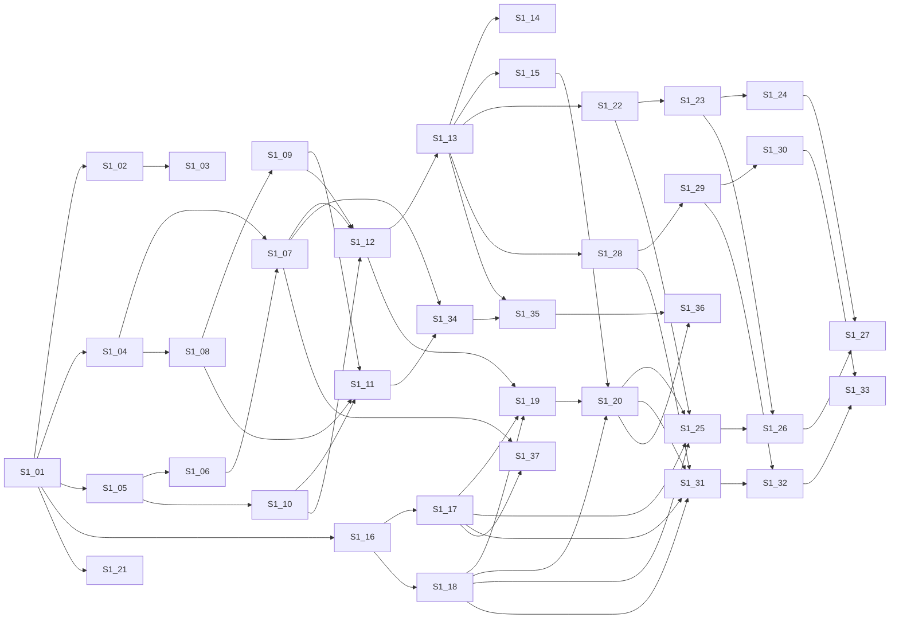

# Tickets

New here? Read [APP_OVERVIEW.md](../APP_OVERVIEW.md), [ROADMAP.md](../ROADMAP.md) and [HOW_WE_WORK.md](../HOW_WE_WORK.md) first.

How to use these: pick the lowest-numbered ticket whose dependencies are all done. Each ticket is one task, sized to fit in one sitting.
Format: Goal (one sentence) / Context / Steps / Done when / Tests / Out of scope. If a title would need "and", it's split into two tickets.

Sizes: XS ≈ under an hour, S ≈ a few hours, M ≈ half a day.

## Sprint 1: foundation (does not depend on pilot results)

Scope: repo, PWA shell, single family login, schema and migrations, kids and subjects CRUD, engine wiring.
Already done overnight (on the build box): the monorepo skeleton, the engine (`@hh/engine` 0.1.0, 128 tests), and `db/001_init.sql` (validated on PostgreSQL 18.4).
So Sprint 1 starts by verifying (S1-01), then builds on top.

### Order and dependencies

| # | Ticket | Depends on | Size |
|---|---|---|---|
| S1-01 | [Verify the skeleton builds on your machine](sprint-1/S1-01-verify-the-skeleton-builds-on-your-machine.md) *(built, verify)* | — | XS |
| S1-02 | [Run the test suite in GitHub Actions](sprint-1/S1-02-run-the-test-suite-in-github-actions.md) | S1-01 | XS |
| S1-03 | [Add a lint command](sprint-1/S1-03-add-a-lint-command.md) | S1-02 | XS |
| S1-04 | [Add a local Postgres with Docker Compose](sprint-1/S1-04-add-a-local-postgres-with-docker-compose.md) | S1-01 | XS |
| S1-05 | [Replace the placeholder HTTP server with Fastify](sprint-1/S1-05-replace-the-placeholder-http-server-with-fastify.md) | S1-01 | S |
| S1-06 | [Load API configuration from environment variables](sprint-1/S1-06-load-api-configuration-from-environment-variables.md) | S1-05 | XS |
| S1-07 | [Add a Postgres connection pool to the API](sprint-1/S1-07-add-a-postgres-connection-pool-to-the-api.md) | S1-04, S1-06 | S |
| S1-08 | [Write the migration runner](sprint-1/S1-08-write-the-migration-runner.md) | S1-04 | S |
| S1-09 | [Write migration 002_auth.sql](sprint-1/S1-09-write-migration-002-auth-sql.md) | S1-08 | XS |
| S1-10 | [Add password hashing helpers](sprint-1/S1-10-add-password-hashing-helpers.md) | S1-05 | XS |
| S1-11 | [Add a seed script for the sample family](sprint-1/S1-11-add-a-seed-script-for-the-sample-family.md) | S1-08, S1-09, S1-10 | S |
| S1-12 | [Add the login endpoint](sprint-1/S1-12-add-the-login-endpoint.md) | S1-07, S1-09, S1-10 | S |
| S1-13 | [Require a valid session on protected API routes](sprint-1/S1-13-require-a-valid-session-on-protected-api-routes.md) | S1-12 | S |
| S1-14 | [Add the logout endpoint](sprint-1/S1-14-add-the-logout-endpoint.md) | S1-13 | XS |
| S1-15 | [Add the current-family endpoint](sprint-1/S1-15-add-the-current-family-endpoint.md) | S1-13 | XS |
| S1-16 | [Add client-side routing](sprint-1/S1-16-add-client-side-routing.md) | S1-01 | XS |
| S1-17 | [Add the app shell layout](sprint-1/S1-17-add-the-app-shell-layout.md) | S1-16 | S |
| S1-18 | [Add a typed API fetch wrapper](sprint-1/S1-18-add-a-typed-api-fetch-wrapper.md) | S1-16 | XS |
| S1-19 | [Build the login screen](sprint-1/S1-19-build-the-login-screen.md) | S1-17, S1-18, S1-12 | S |
| S1-20 | [Redirect signed-out users to the login screen](sprint-1/S1-20-redirect-signed-out-users-to-the-login-screen.md) | S1-15, S1-18, S1-19 | S |
| S1-21 | [Add PNG app icons for installability](sprint-1/S1-21-add-png-app-icons-for-installability.md) | S1-01 | XS |
| S1-22 | [Add the list-children endpoint](sprint-1/S1-22-add-the-list-children-endpoint.md) | S1-13 | XS |
| S1-23 | [Add the create-child endpoint](sprint-1/S1-23-add-the-create-child-endpoint.md) | S1-22 | XS |
| S1-24 | [Add the update-child endpoint](sprint-1/S1-24-add-the-update-child-endpoint.md) | S1-23 | XS |
| S1-25 | [Show the children list screen](sprint-1/S1-25-show-the-children-list-screen.md) | S1-22, S1-17, S1-18, S1-20 | S |
| S1-26 | [Add the add-child form](sprint-1/S1-26-add-the-add-child-form.md) | S1-23, S1-25 | S |
| S1-27 | [Add the edit-child form](sprint-1/S1-27-add-the-edit-child-form.md) | S1-24, S1-26 | S |
| S1-28 | [Add the list-subjects endpoint](sprint-1/S1-28-add-the-list-subjects-endpoint.md) | S1-13 | XS |
| S1-29 | [Add the create-subject endpoint](sprint-1/S1-29-add-the-create-subject-endpoint.md) | S1-28 | XS |
| S1-30 | [Add the update-subject endpoint](sprint-1/S1-30-add-the-update-subject-endpoint.md) | S1-29 | XS |
| S1-31 | [Show the subjects list screen](sprint-1/S1-31-show-the-subjects-list-screen.md) | S1-28, S1-17, S1-18, S1-20 | S |
| S1-32 | [Add the add-subject form](sprint-1/S1-32-add-the-add-subject-form.md) | S1-29, S1-31 | S |
| S1-33 | [Add the edit-subject form](sprint-1/S1-33-add-the-edit-subject-form.md) | S1-30, S1-32 | S |
| S1-34 | [Map database rows to engine inputs](sprint-1/S1-34-map-database-rows-to-engine-inputs.md) | S1-07, S1-11 | M |
| S1-35 | [Add the plan endpoint](sprint-1/S1-35-add-the-plan-endpoint.md) | S1-34, S1-13 | S |
| S1-36 | [Show a plan debug table](sprint-1/S1-36-show-a-plan-debug-table.md) | S1-35, S1-20 | S |
| S1-37 | [Show the engine version in the app footer](sprint-1/S1-37-show-the-engine-version-in-the-app-footer.md) | S1-17, S1-07 | XS |

### Tracks (what can run in parallel)

- **Repo and tooling:** S1-01, S1-02, S1-03, S1-04
- **API foundation:** S1-05, S1-06, S1-07
- **Schema and migrations:** S1-08, S1-09, S1-11
- **Single family login (API):** S1-10, S1-12, S1-13, S1-14, S1-15
- **PWA shell:** S1-16, S1-17, S1-18, S1-19, S1-20, S1-21
- **Kids CRUD:** S1-22, S1-23, S1-24, S1-25, S1-26, S1-27
- **Subjects CRUD:** S1-28, S1-29, S1-30, S1-31, S1-32, S1-33
- **Engine wiring:** S1-34, S1-35, S1-36, S1-37

After S1-01, the tooling track, the API foundation track and the PWA shell track (S1-16 to S1-18) can go in parallel.
Login needs S1-07 + S1-09. The CRUD screens need S1-20 (signed-in shell). Engine wiring needs the seed (S1-11).

### Critical path

S1-01 → S1-04 → S1-08 → S1-09 → S1-12 (with S1-05 → S1-06 → S1-07 and S1-10) → S1-13 → S1-15 → S1-20 → S1-34 (with S1-11) → S1-35 → S1-36

## Sprint 2–3 outline (retired)

The old "pending pilot results" outline was retired on 2026-10-30, when the parent pilot was dropped. Most of it was built in Sprint 2a, Sprint 2b and the timeline sprint below; logging, the offline queue and the week-override sheet were not. What comes next is the core checklist in [ROADMAP.md](../ROADMAP.md); new tickets go in a new sprint folder from there.

## Sprint 2a: schedule data (pilot-independent)

See [sprint-2a/README.md](sprint-2a/README.md): family settings, assignments, days off, recurring events, plain forms, plan contract tests. No timeline UI; the week-overrides API waits for DeeDee's decision on the override-mode rule.

## Review fixes (after the SOLID / best-practices reviews)

See [review-fixes/README.md](review-fixes/README.md): the agreed "do now" items from the developer and tester reviews, RF-01 to RF-12, one commit each.

## Sprint 2b: effort weights, assumed progress, check-ins

See [sprint-2b-weights/README.md](sprint-2b-weights/README.md) (S2b-01 to S2b-38) and `progress/sprint-2b.md`.

## Sprint 2c: fixes from the Sprint 2b verification

See [sprint-2c-fixes/README.md](sprint-2c-fixes/README.md) (S2c-01 to S2c-06) and `progress/sprint-2c.md`.

## Timeline

See [timeline/README.md](timeline/README.md) (T-01 to T-11e) and `progress/timeline.md`. Built after the pilot gate was dropped on 2026-10-28.

## Sprint 3a: fast setup

See [sprint-3a-setup/README.md](sprint-3a-setup/README.md) (S3a-01 to S3a-07), `progress/sprint-3a.md` and `reviews/sprint-3a-verification.md`.

## Sprint 3b: fixes from the Sprint 3a verification

See [sprint-3b-fixes/README.md](sprint-3b-fixes/README.md) (S3b-01 to S3b-07).

## Sprint 4: assignment weekdays, the weekly briefing and "Missed a day?"

See [sprint-4-weekdays-briefing/README.md](sprint-4-weekdays-briefing/README.md) (S4-01 to S4-11).

## Sprint 4b: fixes from the Sprint 4 verification

See [sprint-4b-fixes/README.md](sprint-4b-fixes/README.md) (S4b-01 to S4b-07).

## Sprint 5: event preview, calendar templates and the phone pass

See [sprint-5-preview-templates-phone/README.md](sprint-5-preview-templates-phone/README.md) (S5-01 to S5-10).

## Sprint 6: steering — adjust a week, undo and reset, effort in time

See [sprint-6-steering/README.md](sprint-6-steering/README.md) (S6-01 to S6-11).

## Sprint 6b: a simple This Week

See [sprint-6b-this-week/README.md](sprint-6b-this-week/README.md) (S6b-01 to S6b-04).

## Sprint 7: setup and polish

See [sprint-7-setup-polish/README.md](sprint-7-setup-polish/README.md) (S7-01 to S7-14).

## Sprint 7b: fixes from the Charlotte Mason run

See [sprint-7b-fixes/README.md](sprint-7b-fixes/README.md) (S7b-01 to S7b-07).

## Sprint 8: Soft Paper — the new look, Home and navigation, light and dark

See [sprint-8-soft-paper/README.md](sprint-8-soft-paper/README.md) (S8-01 to S8-10). Absorbs the held S6b-02, S6b-03 and S6b-11.
